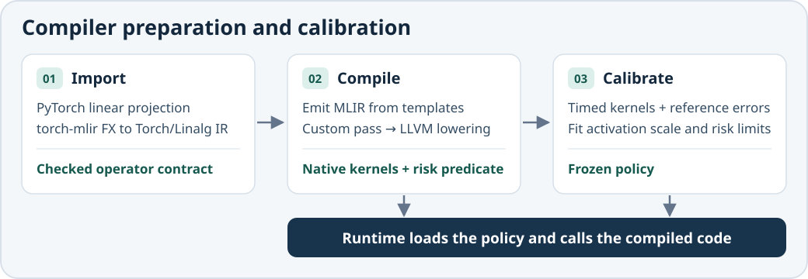
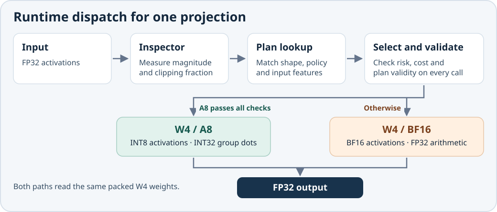

# NeuroMinds Prototype 00

Prototype 00 evaluates adaptive activation quantization for a single CPU linear
projection, `Y = XWᵀ`. The runtime inspects each input and selects one of two
compiled executors. Both use the same packed 4-bit weights (W4).

| Executor | Activation storage | Arithmetic |
| --- | --- | --- |
| W4/A8 | Signed INT8 | INT32 group dot products, followed by FP32 scaling and accumulation |
| W4/BF16 | BF16 | FP32 arithmetic with dequantized W4 weights |

## Architecture



The torch-mlir frontend imports and checks a bias-free PyTorch projection.
Templates emit the two quantized kernels. The custom MLIR pass validates their
interfaces and emits the risk predicate. LLVM compiles both kernels and the
predicate ahead of time. Offline calibration measures error and latency and saves
the activation scale, risk limits, and timing estimates in a frozen policy.



Each call measures the current activations, looks up a cached plan, and checks
whether A8 meets the calibrated risk and cost criteria. A plan may be reused
after these checks. The executor uses BF16 when A8 is unsuitable. See the
[architecture notes](docs/ARCHITECTURE.md) for the cache, validity checks, and
fallback rules.

## Benchmark results

One Ubuntu 20.04 run on an Intel Xeon E7-4820 v3 used one CPU thread, batch size
1, 512 input features, 256 output features, and weight groups of 32. The policy
was fitted on 64 synthetic inputs. Evaluation used 16 separate synthetic
inputs with 15 timed repetitions per mode. All six automated tests in that run
passed.

| Mode | Mean latency (µs) | Mean relative L2 vs W4 reference |
| --- | ---: | ---: |
| FP32 reference | 475.52 | 9.656% |
| Static W4/BF16 | 2,853.68 | 0.156% |
| Static W4/A8 | 566.50 | 47.824% |
| Adaptive W4/A8 or W4/BF16 | 2,240.31 | 0.305% |
| Adaptive with risk guard disabled | 569.53 | 47.824% |

Adaptive execution reduced mean latency by **21.5%** compared with static
W4/BF16. The FP32 C++ reference was the fastest measured mode. The guard accepted
all four held-out inputs that met the 3% A8 error budget and rejected all twelve
that exceeded it.

The 3% budget uses the same W4 weights with FP32 activations as its reference.
Against the original FP32 projection, the adaptive output had **9.71%** mean
relative L2 error. These measurements cover one synthetic operator workload on
one CPU. Model quality, GPU performance, and energy use are outside this
evaluation.

[Run summary][summary] · [Raw measurements][benchmark] · [Build and test log][log]

## Run on an Ubuntu VM

The VM needs `just`, tmux, Git, curl, tar, bzip2, CA certificates, and system
Python 3.8 or later. See the [setup guide](docs/UBUNTU_20_04.md) for installation
and troubleshooting. Start the one-time toolchain setup from the repository root.

```bash
just setup-bg
just status
```

Setup builds LLVM, MLIR, and torch-mlir from source on the first run. It keeps
dependencies under `.deps/` and `.venv/` in this checkout. Once setup reports
`succeeded` with exit status `0`, launch the experiment.

```bash
just start
```

The experiment builds the prototype, runs tests, calibrates the policy,
demonstrates A8 → BF16 → A8 switching, and benchmarks held-out inputs. Both
commands run in tmux and continue when the SSH session closes.

| Command | Use |
| --- | --- |
| `just status` | Check the latest job and its exit status |
| `just logs` | Follow the job log |
| `just attach` | Reconnect to the tmux session. Press Ctrl+B, then D to detach. |
| `just stop` | Stop the active job and retain its logs |
| `just` | List all recipes |

Managed runs write to `results/jobs/<job-id>/experiment/` by default.
Start with `summary.md` for the report, `benchmark.csv` for individual
measurements, and `policy.nm` for the frozen calibration policy.

## Further reading

- [Numerical formats and error definitions](docs/NUMERICS.md)
- [Mapping to the NeuroMinds research methodology](docs/METHODOLOGY_MAPPING.md)

Keep that PATH entry in `~/.bashrc` for future sessions. See the
[official installer](https://just.systems/man/en/pre-built-binaries.html).

## Results and compiler artifacts

### Run a small model

The model workflow accepts a chain of up to 16 dense Linear layers, each with
optional bias and ReLU, and at most 1,000,000 parameters. It packs the supplied
weights into W4 and calibrates each layer using activations from the upstream
BF16 model. Evaluation uses fresh synthetic inputs and propagates the actual
chosen outputs between layers. The compiler still prepares the existing linear
kernels ahead of time. The C++ runtime composes those kernels into the model.

On the configured Ubuntu VM, try the included two-layer example:

```bash
just build
just model-run --model examples/tiny_mlp.txt --results results/tiny-mlp --repeats 5
just model-infer --results results/tiny-mlp --input-file examples/tiny_mlp_input.txt
```

Choose a fresh results directory per run. Use `--backend scalar` on
`model-run` for a scalar-only build. Inference loads the saved model snapshot
and layer policies, then takes whitespace-separated FP32 input values in
row-major order. The input file must contain exactly batch × first-layer-width
values. It prints output rows on standard output and layer decisions on
standard error. Build changes require calibrating a fresh run.

To supply your own model, use the helper from your model's Python code at the
repository root, after loading its weights:

```python
from tools.export_model import export_sequential

# model is a torch.nn.Sequential of Linear and optional ReLU modules.
export_sequential(model.eval(), "my-model.txt")
```

The text format starts with `NM_MODEL_V1 <layer-count>`. Each layer starts
with `linear <input-width> <output-width> <relu|identity> <bias|no_bias>`,
followed by the FP32 weight matrix in output-row-major order and, if declared,
one bias per output feature.

The results directory contains `model_benchmark.csv` for complete-forward
latency and relative output error against the original FP32 model,
`model_decisions.csv` for each adaptive layer's choice and reason, and
`layer-*/` for the original calibration artifacts and frozen policies.
The 3% calibration budget applies to the individual linear operation against
its W4 reference. Final output error is measured separately. Synthetic
evaluation characterizes this small model on these inputs. Transformer graphs,
tokenization, and task accuracy are outside this workflow.

Default managed runs save their console log and actual exit code in
`results/jobs/<job-id>/`. Full experiments put measurements in its `experiment/`
subdirectory: raw calibration/benchmark CSVs, frozen policy, guard metrics,
environment and compiler provenance, and `summary.md` / `summary.json`.
Foreground `just all` uses a timestamped results directory. Results are ignored
by Git; no fabricated measurements are committed.

The full build retains `linear.torch.mlir`, `linear.linalg.mlir`, `frontend.json`,
`nm_config.hpp`, `executors.mlir`, `executors.prepared.mlir`,
`executors.llvm.mlir`, optimized LLVM IR and the native object under
`build/generated/`. Exact resolved host packages and Python versions are
retained and copied into successful experiment provenance.

The frontend recognizes only the specified bias-free projection. Quantized
loops are emitted from a restricted template after that contract is checked.
The real preparation pass validates the executor ABI and emits the risk guard;
it does not transform arbitrary Torch/Linalg graphs or generate descriptor
reductions. This is ahead-of-time preparation, not adaptive JIT compilation.

## Research interpretation

The guard estimates activation quantization risk from calibration-only data.
It never reads the current reference-output error. A8 must also have a measured
total-cost advantage, including inspection/decision overhead, before selection.
The adaptive policy may legitimately retain BF16 for every input. Both kernels
are demonstrated separately in forced mode.

Compare numerical error against both actual W4 storage (activation error) and
original FP32 weights (combined error). BF16 fallback retains W4 weight error.
Cheap statistics do not certify per-input quality, and sampling can miss rare
outliers. Report false-safe and false-fallback rates on held-out inputs.

There is no promised speedup, full LLM inference, KV-cache adaptation, global
MDE controller, runtime JIT or model-quality claim. The NVIDIA GPU is detected
for provenance but is not required by this CPU prototype.

Details: [Ubuntu setup and disconnect/reconnect](docs/UBUNTU_20_04.md),
[architecture](docs/ARCHITECTURE.md), [numerical semantics](docs/NUMERICS.md),
[methodology mapping](docs/METHODOLOGY_MAPPING.md),
[results status](docs/PROTOTYPE_RESULTS.md), and
[supervisor demonstration](docs/SUPERVISOR_DEMO.md).
[summary]: results/jobs/20261117T173353858666Z-all/experiment/summary.md
[benchmark]: results/jobs/20261117T173353858666Z-all/experiment/benchmark.csv
[log]: results/jobs/20261117T173353858666Z-all/experiment/run.log
