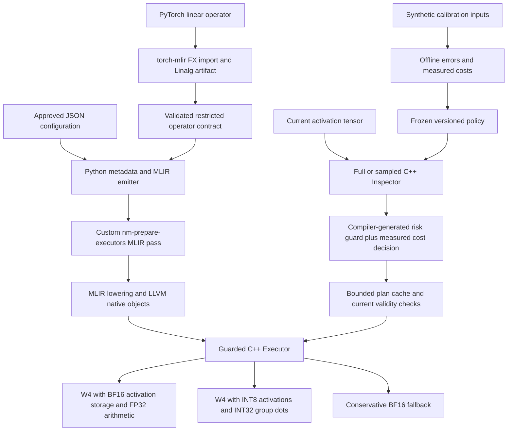

# Architecture

The unit of adaptation is one contiguous, bias-free CPU projection
`X[M,K] * W[N,K]^T -> Y[M,N]`. Weights stay W4 throughout an experiment.

## Offline and build boundaries

`export_linear.py` exports an example `torch.mm(x, w.t())` via `torch.export`
and torch-mlir FX. The pre-lowering graph must contain exactly the transpose
and matrix-multiplication operations. Torch and Linalg IR, a semantic contract
and the Linalg hash are retained. No general graph matching is claimed.

`generate.py` validates the JSON configuration, rejects unsupported formats,
invalid fallbacks, invalid dimensions and unsafe accumulator bounds, then
produces constants and dynamic-shape MLIR loop templates for that operator.
The generated configuration hash includes the frontend provenance.

`nm-opt --nm-prepare-executors` validates the two numerical function signatures
and variant attributes, annotates approvals/version, and emits `nm_risk_guard`.
The generated predicate takes observed maximum, clipping fraction, calibrated
limits and a policy-enabled flag. MLIR lowers that predicate and the kernels
to LLVM IR; `llc` emits the object linked into the runtime. No unimplemented
variant is represented by a function pointer.

The preparation pass is an actual MLIR pass in source. It is not an arbitrary
Torch/Linalg quantization rewrite, does not generate descriptor reductions, and
must be compiled and exercised on the VM before reporting it as working.

## Runtime boundary

Each `Executor::adaptive` invocation performs these operations:

1. Inspect the current tensor using full or bounded deterministic sampling.
2. Build a shape/configuration/policy/backend/feature key and check the cache.
3. Recheck the exact observed risk predicate and current cost decision, even
   when the coarse bucket matches a cached entry.
4. Construct or update a typed plan with variant, fallback, activation-policy
   ID, configuration version and a validity checksum.
5. Validate the plan and tensor contract before dispatch.
6. Convert activations to actual BF16 or INT8 storage, execute the native
   kernel, and check the FP32 output for overflow.

No reference output enters those decisions. Reference execution belongs only
to calibration, tests and held-out evaluation.

The cache is bounded FIFO. Configuration/policy changes invalidate incompatible
entries; eviction is deterministic. Hits reuse the plan object but do not
eliminate inspection. Cache and validity costs are separately timed. The
implementation makes no assumption about a multi-token reuse horizon.

The CLI keeps the same deterministic packed weights across calibration and
evaluation and checks the base seed. The runtime API assumes immutable,
weight-stationary execution for a policy; changing weight contents requires
recalibration and a new policy. An Executor instance is used by one thread.
Future weight-profile switching must add explicit weight-identity/version
metadata to that contract.

The plan checksum detects stale/inconsistent internal metadata; it is not a
cryptographic integrity or adversarial-input security mechanism.

## Fallback and rejection

An unsupported/stale plan, mismatched policy, or failed risk guard uses the
compiled W4+BF16 fallback. Lack of measured A8 advantage also chooses BF16,
but is recorded as a performance decision rather than a risk failure.

Malformed buffers, invalid shapes, nonfinite activations and mathematical FP32
output overflow are rejected. Precision fallback cannot repair a malformed
tensor or make an overflowing result finite.

## Cost and timing

Calibration measures complete forced-variant invocations in alternating order.
The performance predicate compares measured A8 cost plus current inspection
and calibrated decision/cache cost with static BF16 cost, using a configured
margin and a p95 check. Shape/backend-specific policies are required.

Instrumentation separates inspection, cache/validity, decision, activation
preparation, numerical kernel and dispatch residual. Preparation includes a
full activation-domain validation scan, weight/shape checks, allocation and
activation conversion. Dispatch residual also contains output validation and
temporary-buffer destruction. Whole-invocation latency is the primary operator
comparison. Clock instrumentation itself has overhead and can dominate tiny
shapes. No pure arithmetic-only latency is claimed for the FP32 reference.

There is no persistent activation buffer to reformat when switching variants.
Both paths pay activation preparation on every invocation and use the same W4
buffer. Plan changes and dispatch are charged to the measured invocation; no
separate zero-cost switching measurement is asserted.

## Future replacement boundaries

An MLIR graph-rewrite pass can replace the restricted template emitter while
retaining the native ABI. An ORC JIT could later supply compatible executors.
A global MDE controller could supply versioned shared hardware-state buckets.
Those mechanisms are separate future work; the current runtime never compiles
new kernels or reads hardware sensors inside an operator.
