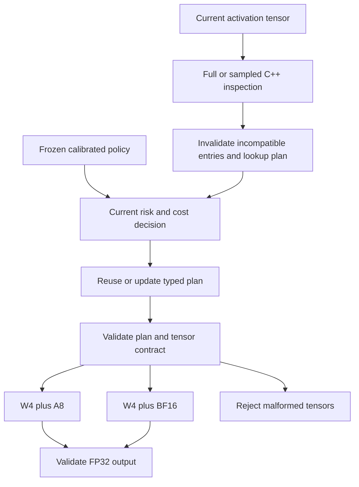

# Member 3 preparation guide

**NeuroMinds: Inspector and guarded executor**  
Prepared from the supplied proposal, supervisor-review memorandum and this checkout on 19 November 2026. Source revision: `18cddf00ceae211fc3216a895ad4fef40b9b5bf8`.

This guide assumes no codebase knowledge. The role assignment follows your supplied four-presenter image: Member 3 owns `inspector.cpp`, `policy.cpp`, `cache.cpp` and `executor.cpp`. The memorandum's workstream labels are broader research responsibilities, not a different assignment of your presentation role.

**Evidence boundary:** This preparation involved reading source, tests and documents. No NeuroMinds build, correctness test, calibration or benchmark was run. The local results directory contains only its README. Examples explicitly labelled illustrative are teaching examples, not measurements. Commands below are for the Ubuntu VM.

## 1. Start here: what you need to be able to say

> My subsystem decides how to execute the current linear projection. It inspects activation statistics, combines a calibration-derived risk rule with measured execution costs, builds or updates a versioned execution plan, and dispatches an approved W4+A8 or W4+BF16 path. It checks current conditions even on a cache hit. If A8 is unsuitable, it uses BF16; malformed tensors are rejected. The guard is an empirical risk predictor, not an accuracy certificate.

Your central question is: **Can input-aware runtime selection choose a useful numerical path without spending more on inspection and decisions than it saves?**

Know these ten facts before learning details:

1. This prototype computes one CPU projection, `Y = X * W^T`, without bias.
2. Weights remain packed W4 on both paths. Runtime adaptation changes activation precision.
3. BF16 stores activations in 16 bits and performs floating-point arithmetic in FP32.
4. A8 stores activations in INT8, performs INT32 dot products within each weight group, then scales into FP32.
5. The inspector reads current activations, fully or by deterministic sampling.
6. Only maximum magnitude and clipping fraction enter the current risk predicate. Other statistics are diagnostic or help form the cache bucket.
7. A8 needs both risk acceptance and a predicted total-cost advantage.
8. Cache reuse does not skip inspection or current risk/cost decisions.
9. Reference-output errors are available during calibration/evaluation, not runtime selection.
10. The current implementation is a restricted operator prototype. Full-model MDE, fused inspectors, KV adaptation and runtime JIT are future work.

### How to study this pack

For a first pass, read sections 1-4 and 8-10, then the separate quick reference. For a code walkthrough, read sections 5-7 and open each listed function. Rehearse sections 13-15 aloud. Use sections 16-18 for the supervisor discussion.

Suggested preparation schedule, adjustable to your available time:

| Session | Work | Check yourself |
|---|---|---|
| 30 minutes | Foundations and the runtime flow | Explain X, W, Y, W4, BF16 and A8 without reading |
| 45 minutes | Read the four owned `.cpp` files and the structures | Trace one ordinary input through `adaptive()` |
| 30 minutes | Cache test and failure cases | Explain why a cache hit can choose another variant |
| 30 minutes | Calibration, cost and metrics | Calculate one risk decision and one cost decision |
| 30 minutes | Script and demo rehearsal | Present within five minutes, then answer ten viva questions |

## 2. The project from zero

### 2.1 Why quantization exists

A neural model stores many numbers called **weights**. During a forward pass, it produces intermediate numbers called **activations**. Using fewer bits for stored numbers can reduce storage and traffic. It also introduces rounding or clipping error and may require unpacking, conversion and scaling. Therefore a smaller representation does not automatically produce faster execution.

**Inference** means running an already trained model. **Post-training quantization** changes numerical representation after training. This prototype does not train or fine-tune a model.

An LLM contains many operations. A linear projection is one common building block. This repository isolates a projection so numerical behavior and runtime overhead can be examined before attempting a complete LLM integration.

### 2.2 Understand the one operation

```text
X: [M, K]       current activation matrix
W: [N, K]       weight matrix
W^T: [K, N]     the transpose of W
Y: [M, N]       output matrix

Y[m,n] = sum over k of X[m,k] * W[n,k]
```

`M` is called `batch`, `K` is `input`, `N` is `output`, and `G` is the weight quantization group size. A group partitions the input dimension of each weight row. The final group may be shorter than G.

Defaults are M=1, K=512, N=256, G=32, seed=4533. There are 512 input activations and 256 output values for that default invocation. These dimensions describe an operator experiment; M=1 does not establish a working token-generation pipeline.

Public activation and output buffers are contiguous, row-major `std::vector<float>` objects. The prototype does not support arbitrary tensor strides.

### 2.3 The two execution paths

| Property | W4+BF16 | W4+A8 |
|---|---|---|
| Weight storage | Two signed 4-bit integers per byte plus group scales | Same packed weights and group scales |
| Activation storage inside execution | Real 16-bit BF16 bit patterns | Real signed INT8 values in [-127,127] |
| Arithmetic | Convert BF16 to FP32; multiply and accumulate in FP32 | INT32 group dot; multiply by activation and weight scales; sum in FP32 |
| Activation scale | BF16 has floating-point representation | One fixed calibration-derived scale per policy |
| Purpose | Conservative activation path | Lower-precision candidate, used only when justified |

BF16 and FP16 are different formats. The implemented fallback is BF16. Also, W4+BF16 is not a full-precision fallback: W4 weight quantization error remains.

Weight quantization uses a symmetric range [-7,7], while the nibble unpacker accepts the complete signed 4-bit range [-8,7]. Those two facts are compatible. Packing is a storage operation; it does not imply native INT4 hardware instructions.

The A8 conversion is:

```text
scaleA = clip / 127
qA = round_away_from_zero(clamp(X / scaleA, -127, 127))
dot_g = sum within group g of int32(qA) * int32(qW)
Y = sum over groups of float(dot_g) * scaleA * scaleW[g]
```

The accumulator resets per group. Both supported backends must follow these same stored-value semantics.

**Why outliers matter, illustrative example:** if clip=4, A8 scale is 4/127. An activation of 40 saturates at integer 127 and reconstructs to about 4, losing most of its magnitude. BF16 can represent a value near 40 without that fixed-range saturation. Conversely, a small value is rounded to the nearest available A8 level, so precision is lost even when there is no clipping. A few large activations can therefore make a fixed-scale A8 path risky. Actual output error also depends on the weights and cancellation in the projection, which is why a maximum-value threshold cannot certify quality by itself.

### 2.4 A small memory calculation

For the default N=256, K=512, G=32, packed weights use `256*ceil(512/2) = 65,536` bytes. Scales use `256*ceil(512/32)*4 = 16,384` bytes. Total payload is 81,920 bytes, or 80 KiB. Original FP32 weights use 524,288 bytes, or 512 KiB. The payload reduction is 6.4 times after including scales.

The 512 activation values occupy 2,048 bytes as FP32, 1,024 bytes as BF16, or 512 bytes as A8. The runtime retains the public FP32 input and allocates conversion buffers, so these storage sizes are not claims about whole-process RSS reduction.

### 2.5 Vocabulary for the compiler and experiment

| Term | Meaning you need here |
|---|---|
| FP32 / BF16 / INT8 | 32-bit floating point / 16-bit bfloat storage / 8-bit signed integer storage |
| Kernel | The implementation of the numerical operation, rather than the whole application |
| Scale and clip | Scale maps integer steps to real values; clip bounds the supported activation range |
| Calibration | Offline examples used to choose numerical parameters, fit thresholds and measure costs |
| Held-out input | An example excluded from fitting and used to evaluate the frozen policy |
| Compiler and IR | A compiler prepares executable code; intermediate representation is its structured form between stages |
| MLIR / LLVM | Compiler infrastructure used for structured intermediate stages and lower-level native code generation |
| Frontend / backend | Import the specified PyTorch computation / execute the scalar or MLIR-native implementation |
| AOT / JIT | Prepare machine code ahead of execution / generate it during execution; this prototype uses AOT |
| ABI | Agreement about function names, argument types and buffer layout between compiled components |
| p95 latency | A percentile: 95% of recorded samples are at or below the reported value under the chosen estimator |
| RSS | Resident Set Size, a process-memory measure rather than only the packed-weight payload |
| Ablation | Disable or alter one mechanism to help identify its contribution |

The source organization reflects this split: Python tools prepare builds and experiments; C++ implements the numerical/runtime machinery; generated MLIR/LLVM artifacts provide compiled implementations. `just` invokes project recipes, `cmake`/Ninja build binaries, and CTest runs registered tests. You do not need to memorize their internals to explain your runtime contract.

## 3. Proposal, revised methodology and actual prototype

The **original proposal** has three phases:

| Phase | Intended purpose |
|---|---|
| I: characterize | Measure sensitivity, quality, hardware costs and switching costs; retain feasible configurations |
| II: prepare | Use compiler infrastructure to create approved implementations and metadata |
| III: adapt | Monitor device/workload state, select an approved configuration, and switch at legal boundaries |

The global runtime is **Monitor-Decide-Execute (MDE)**. Its proposed signals include temperature/frequency, memory pressure, sequence length, KV-cache growth and decode timing. Hysteresis and dwell time are intended to prevent rapid switching.

The **supervisor-review memorandum** proposes adding local **Inspector-Executor (I/E)** specialization. An inspector obtains facts about current inputs that were unavailable at compilation and constructs a plan consumed by numerical execution. A global MDE controller could supply shared system-state information. Local I/E would complement that controller.

This is more than renaming MDE: the extra work is input preprocessing, an explicit plan, and validity/reuse rules. The motivating literature summarized by the memorandum concerns irregular/sparse scheduling and locality. The transfer here is runtime plan construction; it does not establish that sparse scheduling methods improve dense LLM quantization.

### What exists now

| Topic | Implemented in source | Boundary you should state |
|---|---|---|
| Input inspection | Full/sampled C++ activation descriptors | Separate prepass; no fused descriptor reduction |
| Compiler interface | Restricted MLIR executor templates, ABI checks, generated risk predicate | No general graph quantization rewrite |
| Numerical choices | W4+BF16 and W4+A8 | No A4, alternate W profiles or KV formats |
| Runtime selection | Risk check, cost check, typed plan and guarded dispatch | No global MDE controller or live telemetry buckets |
| Reuse | Bounded FIFO plan cache with current checks | No skipped inspection or measured multi-token horizon |
| Policy | Offline fitted, frozen and versioned | No online learning or runtime compilation |
| Evaluation | Synthetic projection workloads and five modes | No full LLM, perplexity, token latency or energy evidence |

The memorandum's conceptual plan has fields such as `valid_until` and hardware/KV buckets. The actual `Plan` does not contain these fields. The memorandum proposes selective reinspection; the prototype reinspects every adaptive call. This is a deliberate scope difference to explain, not something to hide.

Its <5% controller-overhead objective and >=1.2x efficiency objective are research targets. The configuration's `performance_margin=0.05` is a separate per-invocation decision margin. It is not proof that controller overhead is below 5%.

**Source reading:** proposal PDF physical pp. 13-14, 24-35 and 37-41; methodology PDF pp. 2-3, 6-10 and 11-13. Physical PDF pages differ from the proposal's printed chapter page numbers.

## 4. Your ownership and the end-to-end flow

### 4.1 Team handoffs

| Presenter | What you need from them | What you contribute |
|---|---|---|
| Member 1: quantization/calibration | Packed W4 contract, conversion semantics, clip/scale, numerical budget and calibrated policy evidence | Consume the frozen policy and apply its risk/cost rules |
| Member 2: compiler | Approved variant IDs, stable native ABI, generated configuration and risk predicate | Call those compiled functions through guarded dispatch |
| You: inspector/runtime | Current X, shape, W4 weights, policy and backend | Descriptor, plan, selected output, reason, cache counters and timing components |
| Member 4: evaluation | Requests for traces and recorded runtime fields | Explain selection/fallback evidence and hand over the measured results for interpretation |

`policy.cpp` is part of your listed subsystem and includes guard fitting, validation and serialization. Calibration ownership overlaps Member 1: they explain how data and numerical labels were produced; you explain how that becomes a frozen policy and controls runtime selection.

### 4.2 Build-time and runtime are separate

```text
BUILD / OFFLINE
torch.export + torch-mlir -> checked projection contract
JSON configuration -> generated metadata + packed-W4 MLIR loops
nm-prepare-executors -> ABI validation + nm_risk_guard
MLIR -> LLVM IR -> native object -> linked C++ executable
Calibration inputs -> measured errors/costs -> frozen policy.nm

EACH ADAPTIVE INVOCATION
current X -> inspect -> cache lookup -> current risk and cost decision
          -> create/reuse typed plan -> validate -> convert -> kernel -> check Y
```



The inspector itself is handwritten C++. In the MLIR backend, the small boolean risk predicate is generated by the compiler pass. Say **compiler-directed runtime with a generated risk predicate** when describing the implementation precisely.

## 5. Code map and C++ vocabulary

Read the following in order. Line references refer to this reviewed checkout.

| Order | File / anchor | What to understand |
|---|---|---|
| 1 | `include/neurominds/types.hpp:24` | Shape and all runtime data structures |
| 2 | `include/neurominds/runtime.hpp:5` | PlanCache and Executor public interfaces |
| 3 | `src/inspector/inspector.cpp:10` | Descriptor construction, risk, cost and validity keys |
| 4 | `src/runtime/policy.cpp:28` | Guard fitting and policy file checks |
| 5 | `src/runtime/cache.cpp:3` | FIFO reuse and invalidation |
| 6 | `src/executor/executor.cpp:48` | Main adaptive orchestration |
| 7 | `src/executor/executor.cpp:8` | Last validation and dispatch |
| 8 | `src/kernels/kernels.cpp:99` | Conversion and numerical kernel boundary |
| 9 | `tests/test_core.cpp:164` and `:191` | Transition test and same-bucket guard test |
| 10 | `src/benchmark/experiments.cpp:186` | Exact demo sequence and printed fields |

Other useful anchors: `compiler/PrepareExecutors.cpp`, `configs/prototype.json`, `src/runtime/io.cpp:55`, `src/benchmark/experiments.cpp:100`, `:209`, and `docs/ARCHITECTURE.md`.

Basic C++ reading vocabulary:

| Syntax | Meaning here |
|---|---|
| `namespace nm` / `nm::Executor` | Group names under NeuroMinds |
| `struct` | Named fields collected into a data object |
| `class` | Object with methods and private state, such as the cache |
| `const T&` | Read an existing object without copying it |
| `std::vector<float>` | Contiguous dynamically sized FP32 array |
| `enum class` | Typed finite choices, such as A8/BF16 or Scalar/Mlir |
| `std::uint64_t` | Unsigned 64-bit integer used for IDs and keys |
| `throw std::invalid_argument(...)` | Reject an invalid input; main prints ERROR and exits nonzero |
| `#if NM_HAS_MLIR` | Compile this branch only when MLIR support is built |
| `extern "C"` | Stable linker naming for calls into compiled functions |
| `Clock::now()` / `elapsed_us()` | Monotonic elapsed-time measurement in microseconds |

### Objects you must distinguish

| Object | Meaning | Lifetime |
|---|---|---|
| `Descriptor` | Observed activation statistics, count, bytes, sampling flag and bucket | Recomputed for each adaptive call |
| `Policy` | Frozen scale, thresholds, measured costs and calibration identity | Loaded/calibrated for the experiment |
| `PlanKey` | Conditions under which a cached plan is a candidate for reuse | Per lookup and cached entry |
| `Plan` | Chosen variant, fallback, key, activation-policy ID, version and checksum | Cached/reused until replaced or invalidated |
| `Invocation` | Output plus descriptor, plan, reason, flags and timings | One call's result |
| `Counters` | Hits, misses, invalidations and fallbacks | Accumulate inside an Executor |

A policy is a rulebook. A descriptor describes this input. A plan is the current execution choice. The cache stores plans, not outputs, weights or compiled code.

## 6. Inspector: what it reads and computes

Open `src/inspector/inspector.cpp:10` and follow these steps:

1. Validate shape, input element count and positive finite clip.
2. Set observed count to all elements, or at most `sample_size=128`.
3. For each observed value, take absolute magnitude and reject nonfinite values.
4. Accumulate maximum, magnitude sum, clipping count and outlier count.
5. Compute fractions and mean; use a temporary magnitude array and `nth_element` for p99.
6. Build a coarse feature bucket for cache lookup.

| Descriptor field | Exact interpretation |
|---|---|
| `max_abs` | Largest observed absolute value |
| `mean_abs` | Mean of observed absolute values |
| `percentile99` | Nearest-rank 99th percentile: index `ceil(count*0.99)-1` |
| `clipping_fraction` | Fraction with magnitude strictly greater than policy clip |
| `outlier_fraction` | Fraction with magnitude strictly greater than `0.75*clip` |
| `observed` | Number of values inspected |
| `bytes_read` | `observed*sizeof(float)` activation payload bytes |
| `sampled` | Whether fewer than all elements were actually observed |
| `bucket` | Packed, deliberately coarse feature quantization |

The outlier definition is a configured-clip-relative proxy, not a standard-deviation test. Clipping fraction counts values outside the representable clip range; it does not count every rounded value.

**Worked example, matching the test source:** X=[0,-1,2,-5], clip=2. Magnitudes=[0,1,2,5]. Maximum=5, mean=2, p99=5, clipping fraction=1/4, outlier fraction=2/4, observed=4, bytes read=16.

### Full versus sampled

Full mode reads every activation for descriptor computation. Sampled mode reads evenly spaced positions, including endpoints:

```text
index(i) = floor(i * (input_count - 1) / (observed_count - 1))
```

It is deterministic sampling, not random sampling. If the whole tensor has <=128 elements, a `--sampled` request still observes all elements and records `sampled=false`. Calibration and evaluation must agree on the effective mode.

Sampling can miss a finite outlier. The subsequent full activation validation scan checks the legal numerical domain; it does not recompute the full risk descriptor. Thus full validation does not repair sampling's quality-prediction blind spot. Nonfinite values missed by sampling are rejected during preparation before numerical dispatch.

`bytes_read` counts observed activation loads for inspection. It excludes temporary-array traffic, cache-line effects, weight validation and the later conversion/validation passes. It is not a hardware memory-traffic counter.

### The coarse bucket

```text
max_bucket  = min(65535, floor(max_abs / clip * 16))
clip_bucket = floor(clipping_fraction * 65535)
mean_bucket = min(65535, floor(mean_abs / clip * 64))
bucket = max_bucket | (clip_bucket << 16) | (mean_bucket << 32)
         | (uint64(sampled) << 63)
```

Multiple different inputs can share this bucket. This improves the opportunity for plan reuse, but it is never used as a substitute for the exact current risk check. p99 and outlier fraction do not enter either the risk predicate or this bucket.

## 7. Policy: where the rules come from

### 7.1 Offline data and the numerical budget

`calibrate()` in `src/benchmark/experiments.cpp:100` creates deterministic synthetic inputs and actual packed weights. It uses typical normal inputs to fit activation clip, then separate calibration examples to fit the guard.

The four guard/evaluation regimes are normal, outliers, shifted and mixed. The outlier generator explicitly inserts a value of 40 so even tiny shapes have a genuine outlier. These are controlled synthetic regimes, not captured activations from a real model.

The configured activation quantile is 0.9995 (99.95%). Clip fitting uses typical calibration indices 100000..100015, with at most 65,536 collected magnitudes. `clip` is bounded below by 1e-6; `scale=clip/127`. This scale remains fixed at runtime.

The quality label is based on:

```text
relative_L2 = ||Y_variant - Y_W4_reference||_2
              / max(||Y_W4_reference||_2, 1e-12)
safe_label = relative_L2 <= 0.03
```

The W4 reference uses the actual packed integers and scales, with FP32 activations and FP64 accumulation before storing the output. It isolates the additional error from activation precision and numerical execution. Error against original FP32 weights includes weight error too. A 0.03 relative-L2 threshold is not a 3% task-accuracy or perplexity threshold.

### 7.2 `fit_guard()`

`src/runtime/policy.cpp:28`:

1. Start disabled, with zero thresholds.
2. Collect maximum-magnitude and clipping-fraction candidates from calibration rows whose A8 errors meet the budget.
3. Sort and deduplicate; bound each candidate list to at most 64 deterministic values.
4. Try threshold rectangles of the form `max_abs <= maximum AND clipping_fraction <= clipping`.
5. Count all accepted calibration rows and unsafe accepted rows.
6. Choose the largest accepted set that meets the minimum count and allowed unsafe fraction.
7. Leave the guard disabled if no qualifying rule exists.

Defaults require at least 8 accepts and zero unsafe fraction among accepted calibration inputs. This is finite-sample empirical fitting; it does not guarantee zero failures on unseen inputs. The test adds an unsafe row with the same descriptor as a safe row, demonstrating how indistinguishable examples can prevent a zero-false-safe rule.

### 7.3 The actual runtime risk rule

`risk_accepts()` rejects malformed descriptor summaries, then evaluates:

```text
guard_enabled
AND current.max_abs <= policy.max_abs_limit
AND current.clipping_fraction <= policy.clipping_limit
```

The MLIR backend calls `_mlir_ciface_nm_risk_guard`; the scalar backend uses the equivalent C++ predicate. Threshold comparisons are inclusive. The compiler generates the predicate's operations; calibration supplies threshold values. There is no reference-output error input to this function.

### 7.4 Policy identity and validation

`validate_policy()`, `save_policy()` and `load_policy()` live at lines 66, 83 and 91 of `policy.cpp`. A policy contains shape, backend, configuration hash, clip/scale, guard thresholds, cost means/p95s, inspection mode, calibration seed/count and environment identity.

The file begins with `NM_POLICY_V1`, contains a checksum-derived ID and a serialized payload. Loading checks parsing, enum/boolean ranges, unexpected trailing data, checksum, numerical consistency and environment/configuration compatibility. Save writes the checksum; calibration reloads the saved policy to obtain its final ID.

`environment_key()` in `src/runtime/io.cpp:55` includes revision, source/build hash, compiler/build type, CPU model/flags, logical concurrency and OS release. It excludes changing scheduler load. The identity check therefore cannot detect every performance change: contention or VM host changes may still require recalibration.

An unreadable, corrupted or incompatible policy at CLI load is an error. It is not silently accepted and then fixed by fallback. Within runtime execution, stale or incompatible plan conditions can choose BF16. Keep these layers distinct.

## 8. Cost decision: risk acceptance alone is insufficient

`cost_accepts()` is in `src/inspector/inspector.cpp:54`. Calibration measures complete forced BF16/A8 invocations in alternating order, retaining means and p95 values. It also estimates decision/cache overhead. At runtime it uses the current measured inspector time.

```text
overhead = current_inspector_us + calibrated_decision_us

mean condition:
    calibrated_a8_us + overhead
        < calibrated_bf16_us * (1 - 0.05)

p95 condition:
    calibrated_a8_p95_us + overhead
        < calibrated_bf16_p95_us
```

Both conditions must pass. These are comparisons of measured cost estimates, not a fresh benchmark of both variants on the current input. The p95 condition has no additional 5% margin. The descriptor parameter of `cost_accepts()` is currently unused: value-dependent statistics affect the risk decision, while this cost estimate is policy/shape/backend-specific.

**Illustrative arithmetic, not measurements:** BF16 mean=100 us, A8 mean=70 us, current inspection=8 us, decision/cache estimate=2 us. A8 predicted cost=80 us, which is below 95 us. If BF16 p95=120 us and A8 p95=85 us, 95<120 passes too. A8 can be selected if support and risk checks also pass. If A8 mean were 90 us, 100<95 would fail and BF16 would be chosen.

This cost model is a conservative approximation, not a fully itemized prediction of every current wrapper cost. The benchmark's complete adaptive `total_us` is the evidence for actual benefit. If the estimate selects A8 yet measured adaptive execution loses, that is a cost-model finding to report.

The memorandum's general break-even rule is `H * saved_execution_time > inspection + transition`. Current code pays inspection every invocation and does not estimate H or amortize a skipped scan across tokens. Do not claim otherwise.

## 9. Cache and plan validity

### 9.1 Key and plan fields

`PlanKey` contains exact shape (including group), coarse feature bucket, compiled configuration hash, policy ID, backend and the guard-disabled ablation flag. There is no hardware-state bucket, operator ID, weight checksum or KV bucket in the current key.

`Plan` contains this key, selected variant, BF16 fallback, configuration version, activation-policy ID (currently 1) and `validity_key`.

`validity_key()` hashes key fields and plan metadata using an FNV-style 64-bit routine. It detects inconsistent/stale internal metadata. It is not a cryptographic integrity or security feature and does not hash activation or weight contents.

### 9.2 Cache implementation

`src/runtime/cache.cpp` uses a `std::deque<Plan>` and linear lookup. Default capacity is 16; constructor accepts capacities 1..4096.

| Operation | Actual behavior |
|---|---|
| `find` | Search key; verify checksum; return a copied plan and count hit, otherwise miss |
| Corrupt matching entry | Erase, count invalidation and miss |
| `put` existing key | Replace entry in place |
| `put` new key at capacity | Remove oldest entry, count invalidation, append new entry |
| `invalidate` | Erase entries whose config hash or policy ID differs from the active values |

Eviction is **FIFO**, not LRU. A hit does not move the entry to the back. An existing-key replacement does not refresh its insertion position. Invalidation counters include multiple causes, including capacity eviction; they are not solely a count of dangerous plans.

### 9.3 The example to use in your presentation

Read `tests/test_core.cpp:191`, `same_bucket_rechecks_guard()`.

```text
policy.clip = 4
policy.max_abs_limit = 1.03
all elements in X_low  = 1.02
all elements in X_high = 1.04
```

Both inputs have zero clipping. For both, max bucket is `floor(max/4*16)=4` and mean bucket is `floor(mean/4*64)=16`. Therefore the bucket matches.

The test fixture makes A8 cost acceptance easy; its timing constants are artificial and are not performance results. X_low passes the exact 1.03 threshold and selects A8. X_high finds the same cache key, so `cache_hit=true`, but fails the current exact threshold. The runtime replaces the choice with BF16 and reports fallback.

This demonstrates a specific invariant: **matching a cached bucket does not authorize A8 on its own**. It does not demonstrate that the descriptors detect every quality failure.

The cache has no explicit weight identity. The runtime assumes weight-stationary execution for a policy; changing weight contents requires recalibration and a new policy. Shape equality alone would not detect a changed weight tensor.

## 10. Follow one call through the executor

### 10.1 `Executor::adaptive()` at line 48

```text
start whole-call timer
d = inspect(current X)
invalidate cache entries for another config/policy
key = plan_key(shape, d, policy, backend, ablation_mode)
hit, plan = cache.find(key)

supported = policy matches shape/backend/config/effective inspection mode
            AND policy ID exists AND A8 is approved
risk_ok = guard_disabled OR risk_accepts(d, policy)
faster = cost_accepts(d, policy, current_inspector_time)
selected = A8 if supported AND risk_ok AND faster else BF16

if cache miss OR cached variant differs from selected:
    create plan with BF16 fallback, current version and checksum
    cache.put(plan)

result = execute(current X, weights, shape, policy, plan, d)
attach cache status, timing components and a reason
count fallback for unsupported/risk-rejected cases
return result with complete adaptive elapsed time
```

The order matters: cache lookup occurs before the fresh selection. A hit supplies a candidate plan, not permission to skip selection. Both risk and cost are reconsidered on every adaptive invocation.

Reasons distinguish unsupported policy context, risk rejection, no cost advantage and successful acceptance. All-BF16 decisions can therefore have different explanations.

### 10.2 `Executor::execute()` at line 8

This is the final plan-consuming layer:

1. Validate shape and tensor dimension consistency.
2. Reconstruct the expected key using the supplied current descriptor.
3. Check policy compatibility, key equality, configuration version, BF16 fallback, activation-policy ID, checksum and legal variant.
4. If plan validity fails, or an A8 plan is unapproved/current-risk-rejected, construct a BF16 fallback plan.
5. Require an approved conservative path.
6. Call `run_kernel()`; return output, plan, reason and timing fields.

For A8 it rechecks current risk unless the explicitly labelled ablation disables that check. The final layer does not rerun the cost predicate; cost selection occurs in `adaptive()`.

### 10.3 Kernel preparation and execution

`run_kernel()` validates the entire activation buffer and packed weights, checks backend availability, allocates/resizes buffers, converts activations to the selected stored type, and calls either the C++ scalar kernel or the MLIR-generated native function.

Native MLIR calls use C-compatible memref descriptors: pointer information, offset, size and stride describe contiguous arrays. Member 2 owns the full ABI details; you need to know that the runtime must supply matching buffers and dimensions.

Output values are checked for FP32 overflow after the kernel. An invalid tensor, impossible numerical domain or overflowing output raises an error. Returning to BF16 cannot repair these conditions.

### 10.4 BF16 choice versus fallback

| Event in normal adaptive use | Selection / behavior | `fallback` meaning |
|---|---|---|
| Supported + risk accepts + cost accepts | A8 | false |
| Risk rejects | BF16 | true |
| Policy context unsupported | BF16 | true |
| Risk accepts but no cost advantage | BF16 | normally false |
| Invalid/stale/unsupported plan at final dispatch | BF16 plan repair | true |
| Invalid tensor/domain or output overflow | Error | No successful repaired invocation |

Thus `selected=w4_bf16` alone does not prove guard rejection. Read `reason` and `fallback`. In unusual direct low-level calls, plan validation can independently set fallback too.

## 11. Timing, metrics and what proves your subsystem

### Timing fields

| Field | What it covers |
|---|---|
| `inspector_us` | Descriptor construction in the adaptive wrapper |
| `validity_us` | Cache/invalidation work plus final plan validity checks |
| `decision_us` | Support/risk/cost selection and plan update |
| `preparation_us` | Full validation, weight/shape checks, allocations and activation conversion |
| `kernel_us` | Numerical kernel call, with backend wrapper details |
| `dispatch_us` | Residual around the kernel boundary, including output validation and temporary destruction |
| `total_us` | Complete invocation; primary latency comparison |

The components need not sum perfectly to total because timer calls and surrounding work also cost time. Instrumentation can dominate tiny shapes. `policy.inspection_us` is the calibration average; current cost selection uses the measured current inspection time instead.

The original FP32 reference has only whole-invocation timing; its CSV `kernel_us=0` means unavailable arithmetic-only timing, not zero computation.

### Guard classification: state the denominator

Held-out examples are labelled safe/unsafe by actual forced A8 error against the W4 reference. Guard prediction is evaluated independently of whether cost selection finally uses A8.

| | Actually safe | Actually unsafe |
|---|---|---|
| Guard accepts | Correct accept | False-safe |
| Guard rejects | False-fallback | Correct reject |

The repository reports:

```text
false_safe_rate_among_unsafe = false_safe / actual_unsafe
false_fallback_rate_among_safe = false_fallback / actual_safe
unsafe_fraction_among_accepted = false_safe / all_guard_accepts
```

Undefined denominators become JSON null. The last fraction is also the type of unsafe fraction constrained during guard fitting. It is different from the first held-out rate.

**Illustrative example:** 30 unsafe inputs include 3 accepted ones; 70 safe inputs include 14 rejected ones. False-safe rate among unsafe=3/30=10%; false-fallback among safe=14/70=20%; accepts=(70-14)+3=59; unsafe fraction among accepts=3/59, approximately 5.1%. Always identify which rate you are discussing.

### Tests to show

| Function in `tests/test_core.cpp` | Evidence it is designed to provide |
|---|---|
| `inspector()` at 118 | Exact descriptor arithmetic and sampling behavior |
| `guard_calibration()` at 131 | Fit/reject an empirical guard, including indistinguishable inputs |
| `quality_is_separate()` at 155 | Correct A8 implementation can still have poor quantization quality |
| `cache_and_executor()` at 164 | Ordinary reuse, outlier fallback, stale version, invalid variant, changed policy and cost refusal |
| `same_bucket_rechecks_guard()` at 191 | Current exact guard can override a matching cached bucket |
| `generated_guard_equivalence()` at 202 | Generated/scalar predicate agreement at boundaries and when disabled |
| `bounded_cache()` at 214 | FIFO capacity and invalidation |
| `policy_roundtrip()` at 227 | Saved policy loading and invalid-policy rejection |

Tests contain 15 scalar/basic cases, with 3 additional cases when MLIR is compiled. Those are individual cases inside the C++ test binary, not the number of CTest entries. A full MLIR build also adds frontend/compiler CTest entries. Show actual output instead of assuming all cases ran or passed.

Implementation correctness means a variant agrees with its independent numerical reference. Quantization quality means its error meets the chosen budget. Runtime correctness means selection, invalidation and fallback obey the contract. Performance benefit is a separate measured outcome.

## 12. Runbook and evidence collection

All commands in this section are for the configured Ubuntu VM, inside its repository checkout. The repository CLI intentionally rejects Windows builds/experiments. Preparing this guide did not execute these commands.

### 12.1 If the VM is already set up

```bash
cd ~/prototype-00
just status
just doctor
just build
just test
just metadata
```

Avoid starting another managed job while one is active. `just status` reports saved job state; `just attach` reconnects. Detaching from tmux is not successful completion. Read `docs/UBUNTU_20_04.md` if setup is incomplete; `just setup` builds the isolated toolchain and can be lengthy.

### 12.2 Your focused demonstration

The following uses a new, consistently named evidence directory and policy; choose another name for later independent runs.

```bash
mkdir -p results/member3-review
just calibrate --results results/member3-review --policy results/member3-review/policy.nm
just demo --results results/member3-review --policy results/member3-review/policy.nm
```

Defaults must agree between calibration and demonstration. If you change shape, backend, seed or effective sampling mode, use matching options and a separately calibrated policy.

The actual demo loops five times: **ordinary, ordinary, outlier, ordinary, ordinary**. It reuses the identical ordinary tensor. Then it runs the two variants forcibly on the ordinary tensor and prints counters. These forced runs demonstrate implementations; they do not establish adaptive A8 selection.

Read each printed field: regime, max, mean, p99, clipping, outliers, inspected count/mode, cache, selected, fallback, error_w4, total_us, kernel_us, inspector_us and reason. Displayed numbers are rounded, so very small fractions may look like zero.

The demo may select BF16 for all five calls. Explain the actual `reason`: no calibrated rule, input risk, policy compatibility or no cost benefit. Do not edit timing fields or thresholds to create a favorable adaptive trace.

### 12.3 Measure and package evidence

```bash
just bench --results results/member3-review --policy results/member3-review/policy.nm
just summarize results/member3-review
just collect results/member3-review
```

This foreground sequence produces useful operator evidence but does not automatically gather every compiler/build artifact that the full workflow copies. For a full reproducibility bundle use `just run` (attached tmux), `just start` (detached), or foreground `just all`; they perform build, tests, calibration, demo, benchmark, provenance copying and summary generation. Managed full-run data lives under `results/jobs/<job-id>/experiment/`.

For sampled inspection, use a distinct experiment:

```bash
just all --sampled
```

Keep the resulting policy and held-out evaluation separate from the full-inspection experiment. `just sweep` independently calibrates batches 1, 4, 8 and 16.

### 12.4 Evidence to have open before presenting

| Artifact | What you point to |
|---|---|
| Actual CTest output | Which runtime and MLIR checks actually passed |
| `policy.nm` and calibration console | Frozen scale, enabled guard and measured costs |
| Demo console / full-run `run.log` | Descriptor -> cache -> selection -> reason -> output |
| `tests/test_core.cpp:191` | Same bucket, fresh guard rejection |
| `benchmark.csv` | Complete latency and component times, selection/fallback fields |
| `guard_metrics.json` | Held-out error classification and denominators |
| `summary.md` / `summary.json` | Measured comparison and paired uncertainty |
| `build/generated/executors.prepared.mlir` | Generated risk predicate; coordinate with Member 2 |

The supplied checkout has no raw results or native build artifacts to inspect. `docs/PROTOTYPE_RESULTS.md` records that an earlier supplied VM log reached benchmark completion and then failed in report formatting; the formatting fix is in source. This is a repository-recorded status, not fresh verification of that VM run.

To recover that recorded run's report on the VM, if its data is still present:

```bash
just summarize results/jobs/20261117T173353858666Z-all/experiment
```

Regenerating a report does not change the original job's historically failed exit status.

## 13. Presentation outline and a five-minute script

Use four slides for your part. This is slide content and speaker guidance; it does not assume a particular presentation application.

| Slide | Put on screen | Show as evidence |
|---|---|---|
| 1. Input-aware runtime decision | Current X -> descriptor -> risk + cost -> plan -> executor | Small runtime flow diagram |
| 2. Descriptor and selection | Max and clipping rule; total-cost inequalities | `inspector.cpp` and policy fields |
| 3. Reuse with current checks | Key, version, checksum; same bucket can cross threshold | `same_bucket_rechecks_guard()` |
| 4. Guarded execution and boundaries | A8/BF16/reject outcomes; timing components; scope | Actual demo and tests |

### Transition from Member 2

> Member 2 has shown how the two numerical paths and the risk predicate are prepared. I will show how the runtime uses the current activations and the frozen policy to decide which path may execute.

### 0:00-0:45 - Purpose

> Our prototype computes one CPU linear projection, Y equals X W transpose. Both execution paths use the same packed W4 weights. What changes is the activation path: BF16 storage with FP32 arithmetic, or A8 storage with INT32 accumulation within each weight group and FP32 scaling. My subsystem inspects the current input, constructs a typed plan and guards dispatch. It cannot invent a new precision format at runtime.

### 0:45-1:45 - Inspection and selection

> The inspector computes maximum magnitude, mean magnitude, p99, clipping fraction and an outlier proxy. We support a full scan and deterministic bounded sampling. The current risk rule uses maximum magnitude and clipping fraction. Its thresholds come from calibration-only output errors; at runtime, the inspector never sees the current reference-output error. Passing the guard means empirically predicted low risk, not a proof of accuracy.
>
> We also require a cost advantage. The runtime compares calibrated complete A8 cost plus current inspection and estimated decision overhead against BF16, with a five-percent mean margin and a separate p95 condition. Therefore an input can pass the risk rule and still use BF16 because A8 is not worthwhile.

### 1:45-2:45 - Plan reuse

> The plan records the selected variant, BF16 fallback, activation-policy ID, configuration version and validity checksum. Its cache key includes shape, a coarse activation bucket, configuration, policy, backend and ablation mode. The cache is bounded FIFO.
>
> A hit does not skip inspection. This test uses two inputs with the same coarse bucket: 1.02 and 1.04, around an exact threshold of 1.03. The first can select A8. The second finds the cached key but fails the fresh guard, so it uses BF16. That prevents a bucket match from authorizing a stale numerical choice.

### 2:45-3:45 - Final execution

> Before execution, we validate the plan against current metadata. An invalid version, checksum, unsupported variant or failed A8 guard produces a BF16 plan. The kernel boundary validates the complete tensor and packed weights, converts activations into real BF16 or INT8 storage, then calls the selected native function. Invalid tensors and output overflow are rejected because precision fallback cannot repair them.
>
> We record inspection, validity/cache, decision, preparation, kernel, dispatch residual and total latency. Whole-invocation time is the important comparison because a kernel improvement can disappear after runtime overhead.

### 3:45-4:30 - Demonstration

> The demo uses an ordinary input twice, an outlier input, then the same ordinary input twice again. I will read the descriptor, cache field, selected path, fallback flag and reason together. The displayed output error is evaluation-only. If all adaptive calls choose BF16, the reason explains why. The separate forced runs show both implementations, rather than proving adaptive A8 selection.

### 4:30-5:00 - Scope and handoff

> This establishes the source design for a local operator-level runtime. The inspector reductions are currently C++, while the risk predicate and numerical paths are prepared through the compiler pipeline. Global MDE coordination, fused inspection and full-model evaluation remain future work. Member 4 will now show what the available measurements establish about risk prediction, total overhead and limitations.

If a fresh successful VM run is available, replace the cautious evidence wording with the exact verified test/run status. Do not say that tests passed based on this preparation alone.

### One-minute version

> I own the inspector and guarded executor. Each call inspects the current activations, applies a calibration-derived maximum-and-clipping risk rule, and requires a predicted total-cost advantage before choosing A8. The plan is versioned and cached, but a hit still rechecks current conditions. Invalid plans use the W4+BF16 fallback; malformed tensors are rejected. Both paths share W4 weights, and runtime selection never reads reference-output error. Our key evidence is the current-guard cache test, the normal/outlier/normal demo, and complete-invocation timing. The guard remains an empirical predictor, and full-model benefit must be demonstrated separately.

## 14. Likely supervisor questions: concise answers

### Foundations and motivation

**1. What is your individual contribution?**  
I explain and own the runtime interface between activation features, the frozen policy, cached typed plans and guarded numerical dispatch, including invalidation, fallback and overhead evidence. Code ownership claims should match the team's actual contribution record.

**2. Why not always use A8?**  
It may introduce unacceptable activation error and may be slower once conversion, unpacking, inspection and dispatch are counted.

**3. Why not always use BF16?**  
That is a legitimate baseline. Input-aware adaptation is useful only if eligible inputs gain enough from A8 to justify its costs without unacceptable risk.

**4. Does changing input values change dense matrix multiplication latency?**  
The memorandum explicitly cautions against assuming that. Here input descriptors chiefly predict numerical risk; the policy uses calibrated variant costs. Value-dependent latency benefit must be separately measured.

**5. How is this I/E rather than just monitoring?**  
The local inspector preprocesses the operator's current input and feeds explicit plan construction. The executor consumes a supported representation/variant choice with validity rules. Global device monitoring is a different proposed responsibility.

**6. What remains of the original MDE architecture?**  
It remains the wider design. A future shared monitor would supply coarse system state; local I/E would resolve input-level choices. This checkout does not implement that full integration.

### Risk and numerical semantics

**7. Does the guard guarantee accuracy?**  
No. It is fitted to finite calibration data using cheap descriptors. We must measure held-out false-safe behavior and ultimately model quality.

**8. What actually enters the guard?**  
Maximum absolute activation, clipping fraction, their calibrated limits and an enabled flag. Mean helps the cache bucket; p99 and outlier fraction are recorded diagnostics.

**9. Why collect p99 if it is not used?**  
It supports characterization and future feature comparisons. It also costs time and temporary storage. A feature-removal ablation could test whether that expense is justified in the deployed inspector.

**10. Why does calibration use output errors if runtime must not?**  
Offline errors label training/calibration cases. The fitted thresholds are frozen. Runtime only reads the current descriptor and that frozen policy.

**11. What happens when no guard can be fitted?**  
`guard_enabled` stays false, so normal adaptive execution cannot accept A8 on risk grounds and uses BF16.

**12. Why is BF16 the fallback if weights are W4?**  
It is conservative for activation representation within the fixed-W4 experiment. It does not recover original FP32 weight accuracy.

**13. Is A8 implemented as floating-point dot products on dequantized activations?**  
No. Stored INT8 activations multiply unpacked signed W4 integers into INT32 group accumulators. Group results are then rescaled into FP32.

**14. Can sampled inspection miss an outlier?**  
Yes. It inspects fixed evenly spaced positions. Full domain validation later can reject nonfinite/illegal values, but it does not restore missed finite outliers to the risk descriptor.

**15. What does the 3% error budget mean?**  
Relative L2 tensor-output error against the actual W4 reference is at most 0.03 for a safe label. It is not a task-accuracy, perplexity or per-token guarantee.

### Plan reuse and validity

**16. What is cached?**  
A small typed execution plan, not compiled code, numerical output or the activation descriptor scan.

**17. Why inspect again on a hit?**  
The cache key uses coarse features. Current activations can change enough to cross an exact risk threshold while retaining the same bucket.

**18. What makes your cache safe?**  
Bounded storage, policy/configuration invalidation, metadata checksum and fresh risk/cost decisions reduce stale-plan errors. These measures do not turn the empirical risk guard into an accuracy guarantee.

**19. Is this LRU?**  
No, FIFO. Hits do not update order, and same-key replacement retains its position.

**20. Can a cache hit still report fallback?**  
Yes. A hit records a matching candidate key; fresh selection may reject A8 and update the plan to BF16.

**21. What invalidates a plan?**  
Examples include different policy/configuration, invalid metadata/checksum, changed current selection, or capacity eviction. The current key separates exact shapes, backends and ablation mode too.

**22. What if weights change but shape stays the same?**  
The cache has no weight-content identity. The contract requires weight-stationary execution; changed weights require recalibration and a new policy. Supporting hot weight swaps would need explicit identity/version metadata.

**23. Is the checksum a security mechanism?**  
No. It is an internal consistency check, not cryptographic validation of tensors or policies against adversarial modification.

### Cost, execution and evaluation

**24. Do you benchmark both paths on every input to decide?**  
No. Runtime uses frozen calibrated variant costs and current measured inspection time. Reference and forced-path executions are calibration/evaluation work.

**25. Does guard-disabled force A8?**  
No. It bypasses risk acceptance, but support checks, cost selection, tensor validation and legal dispatch remain. It can still select BF16.

**26. Can all adaptive calls using BF16 still be a correct result?**  
Yes. It may mean the policy lacks reliable discrimination or A8 lacks a cost advantage. The research benefit is then absent or unestablished; implementation correctness and performance value are separate.

**27. Is every BF16 selection counted as fallback?**  
No. A purely performance-driven BF16 choice normally has `fallback=false`; risk/unsupported/invalid-plan conditions count as fallback.

**28. How much overhead have you achieved?**  
Answer from a verified run's total and component times. This checkout alone does not provide measurements. The wider <5% goal has not been established by the code or by this guide.

**29. Where is switching cost?**  
Each call converts activations, chooses a path and dispatches within its measured invocation. There is no persistent activation buffer that must be reformatted across variants. A distinct zero-cost switching claim would be incorrect.

**30. What if hardware contention changes?**  
The environment identity check catches some platform/build changes but excludes transient load. Measured policies can become stale under contention; recalibration and future shared hardware-state modelling are needed.

**31. What is the strongest runtime test to show?**  
The same-bucket threshold-crossing test: identical coarse key, fresh rejection, BF16 selection. Also show stale-version and invalid-variant handling from `cache_and_executor()`.

**32. What are the five benchmark modes?**  
Original FP32 reference, static W4+BF16, static W4+A8, guarded adaptive, and guard-disabled adaptive ablation. These are operator baselines, not a completed comparison with full-model state-only MDE.

**33. What is your main performance metric?**  
Complete invocation latency. Kernel time helps explain behavior, but cannot by itself establish net benefit.

**34. How do you avoid calibration leakage?**  
Frozen policy and disjoint seeded calibration/held-out inputs. SplitMix64 uses a reserved high bit to separate the two seed sets for a fixed base seed. Do not refit on the benchmark results.

**35. What uncertainty is reported?**  
The summary resamples paired mean latencies across distinct held-out inputs. It does not establish variability across independent VM sessions or devices. Member 4 should interpret actual intervals.

### Scope and next research step

**36. Is the inspector compiler-generated?**  
Current descriptor computation is C++. The compiler pass generates the risk predicate and prepares/validates the numerical interface. Generating or fusing descriptor reductions is future work.

**37. Is there JIT or online compilation?**  
No. Kernels and predicate are prepared ahead of time. Runtime selects among existing paths.

**38. Where are hysteresis, dwell time and hardware-state buckets?**  
They are part of the wider methodology, not this implementation. This prototype can change its choice at each operator call and does not implement a global anti-oscillation policy.

**39. Can you claim the feasibility gates passed?**  
Source provides mechanisms and tests for G0, synthetic evidence collection for G1 and partial operator cost evaluation for G2. Passing requires actual reviewed results. G3 requires full-model comparison and is future work.

**40. What would you improve first?**  
Use measured failures to choose: improve held-out risk discrimination if false-safe behavior is poor; remove or fuse costly statistics if inspection dominates; optimize the numerical kernel if A8 is slow. Then test real-model activations and add explicit state/weight validity before broad integration.

## 15. Troubleshooting during a demonstration

| Observation | Likely explanation / next step |
|---|---|
| Policy file missing | Calibrate first with the same `--policy` path |
| Environment/code fingerprint changed | Rebuild/recalibrate in that VM context; keep previous evidence separate |
| Shape/backend/mode/base-seed mismatch | Supply the calibration options or create a matching new policy |
| All calls use BF16 | Read guard-enabled status, risk descriptors and measured cost reason |
| Guard-disabled still uses BF16 | Cost or support check can still reject A8 |
| Outlier does not change selection | BF16 may already be selected; inspect descriptor and reason rather than assuming a switch |
| Hit and fallback appear together | Matching candidate key followed by current rejection is allowed |
| Expected hit becomes a miss | Check bucket, policy, mode, backend, capacity eviction and input identity |
| `MLIR executors compiled=0` | Scalar build; do not claim it validates native MLIR paths |
| Invalid activation / output overflow error | Rejected domain; BF16 fallback cannot repair all inputs |
| Summary failed after benchmark saved | Preserve CSV/logs; rerun summarize after fixing the reporting issue |
| SSH disconnect | Reconnect, inspect `just status`, then `just attach`; detachment is not completion |

If a live demo fails, explain the observed layer and use a previously recorded trace whose revision, policy and environment are identified. Do not present a prepared expected-output example as actual execution.

## 16. Deeper implementation caveats you should know

These are boundaries found by reading the implementation, not claims that the code has failed in a measured run.

- **Low-level trust boundary:** `execute()` accepts a caller-supplied descriptor; it does not independently rerun `inspect()`. Normal `adaptive()` creates a fresh descriptor. Direct callers must honor that internal contract; passing a forged or stale descriptor is outside the protected path.
- **Policy immutability:** structure/environment validation occurs at load/calibration. The fast path assumes that frozen policy remains consistent. Editing fields in memory without changing identity can violate the intended contract.
- **Weight identity:** shape validation checks geometry, not whether the weights are the calibrated values. Weight-stationary execution is an explicit requirement.
- **Cost approximation:** the cost predicate includes current inspection plus a calibrated decision/cache estimate, rather than all current adaptive overhead as separate predictions. Complete measured latency must validate the estimate.
- **No rollback quality check:** the executor checks finite output, not current output error. It does not run A8, compare against a reference, then automatically retry BF16 on a quality failure.
- **Concurrency:** an Executor has mutable cache/counters and is intended for one thread. Shared concurrent use would require synchronization or separate instances.
- **Limited reuse savings:** repeated input/feature regimes can reuse the small plan, but scanning, selection, conversion and computation still happen. Cache hits alone are not evidence of substantial amortization.
- **Extra descriptor work:** mean/p99/outlier diagnostics cost time even though the deployed guard uses two features. A minimal-feature comparison would reveal the tradeoff.

These points are useful if a supervisor presses on the meaning of "guarded." The runtime checks a stated contract; it does not claim unrestricted robustness to arbitrary callers or formal numerical certification.

## 17. Research discussion: what evidence would justify expansion?

The memorandum's gates provide a useful order:

| Gate | Question | Evidence your part supplies |
|---|---|---|
| G0 | Can both paths run correctly and transition legally? | Native/scalar reference agreement, plan checks and transition tests |
| G1 | Do descriptors contain useful information? | Held-out guard confusion counts and regime-conditioned errors |
| G2 | Does inspection pay for itself? | Complete latency, component overhead, reuse behavior and honest non-benefit |
| G3 | Does a whole model improve? | Future integration with state-only MDE and strong matched-memory static baselines |

Useful next experiments for your workstream:

1. Compare full and sampled inspection on disjoint held-out inputs, especially isolated outliers missed by the sample positions.
2. Remove diagnostic-only statistics and measure the change in cost and scientific information.
3. Compare cache enabled/disabled while retaining identical current checks, to isolate plan-reuse benefit.
4. Collect real LLM activation traces and test whether the synthetic guard transfers before claiming model-level value.
5. Evaluate external versus safely fused inspection with identical numerical/guard semantics.
6. Add explicit immutable weight identity and shared hardware-state versions before supporting those dynamic changes.
7. Introduce hysteresis/dwell controls only with a defined validity and cost model; never retain an A8 path through a failed current risk guard merely to reduce switching.

A negative result is scientifically useful: high overhead, weak descriptors or no A8 advantage can justify retaining a simpler static or original MDE architecture. It is not evidence of a speedup, and should not be presented as one.

## 18. Final self-test and reading references

Try these without looking at the guide:

1. Write the shapes of X, W and Y and explain the transpose.
2. Explain how BF16 arithmetic differs from A8 arithmetic in this code.
3. Calculate the worked four-value descriptor.
4. Write the exact risk predicate, including the enabled flag.
5. State both cost conditions and where their values come from.
6. Explain Policy versus Descriptor versus Plan.
7. List every PlanKey field and two intentionally absent fields.
8. Explain FIFO and why a hit does not update recency.
9. Walk through the 1.02/1.04 cache test.
10. Give a BF16 selection that is not a fallback.
11. Distinguish plan fallback, policy-load failure and tensor rejection.
12. Explain why sampled inspection plus full domain validation still can miss quality risk.
13. Define all three guard rates with their denominators.
14. State which overhead is paid again on a cache hit.
15. State three capabilities described in the methodology but absent from the prototype.

You are ready when you can answer these and trace `adaptive()` with the source open in under three minutes.

### Source references

**Supplied documents**

- `C:/Users/USER/Downloads/NeuroMinds Proposal.pdf`: original three-phase architecture, O3/O4, MDE, transition/fallback rules and evaluation constraints. Relevant physical PDF pages: 13-14, 24-35, 37-41.
- `C:/Users/USER/Downloads/NeuroMinds_Inspector_Executor_Methodology_Supervisor_Review.pdf`: proposed I/E extension, explicit hypothesis status, local/global distinction, workstreams, gates and cost model. Relevant pages: 2-3, 6-13. The cover dates it 7 October 2026 and marks it proposed/not validated.
- Supplied role image: Member 3 assignment and the M4 -> M1 -> M2 -> M3 -> M4 speaking flow.

**Repository evidence**

- `include/neurominds/types.hpp`, `runtime.hpp`, `inspector.hpp`: exact runtime structures and public interfaces.
- `src/inspector/inspector.cpp`, `src/runtime/policy.cpp`, `src/runtime/cache.cpp`, `src/executor/executor.cpp`: core Member 3 behavior.
- `src/kernels/kernels.cpp`, `src/quantization/quantization.cpp`: numerical dispatch, conversion and rejection semantics.
- `src/benchmark/experiments.cpp`, `src/runtime/io.cpp`: calibration, demo, held-out evidence and environment identity.
- `compiler/PrepareExecutors.cpp`, `tools/generate.py`, `CMakeLists.txt`: generated predicate, metadata and native build/test boundaries.
- `tests/test_core.cpp`: test designs described here, not asserted test-run success.
- `configs/prototype.json`: default policy/configuration constants.
- `docs/ARCHITECTURE.md`, `docs/NUMERICS.md`, `docs/METHODOLOGY_MAPPING.md`, `docs/SUPERVISOR_DEMO.md`, `docs/PROTOTYPE_RESULTS.md`, `README.md`, `justfile`, `tools/nm_cli.py`: scope, status and command behavior.

Documents were treated as source material describing research plans. Their internal approval requests, suggested future actions and targets were not treated as instructions to execute or as completed results.
